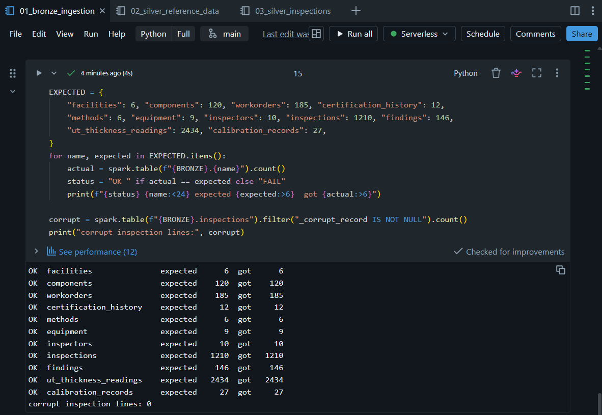
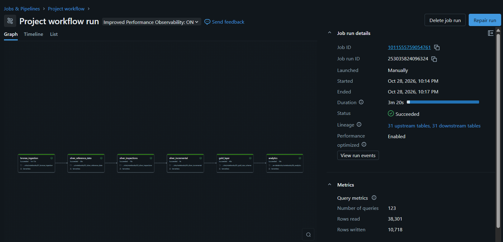
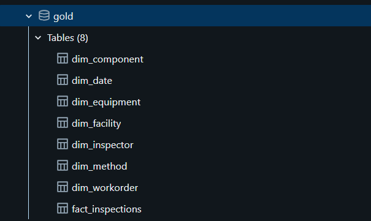
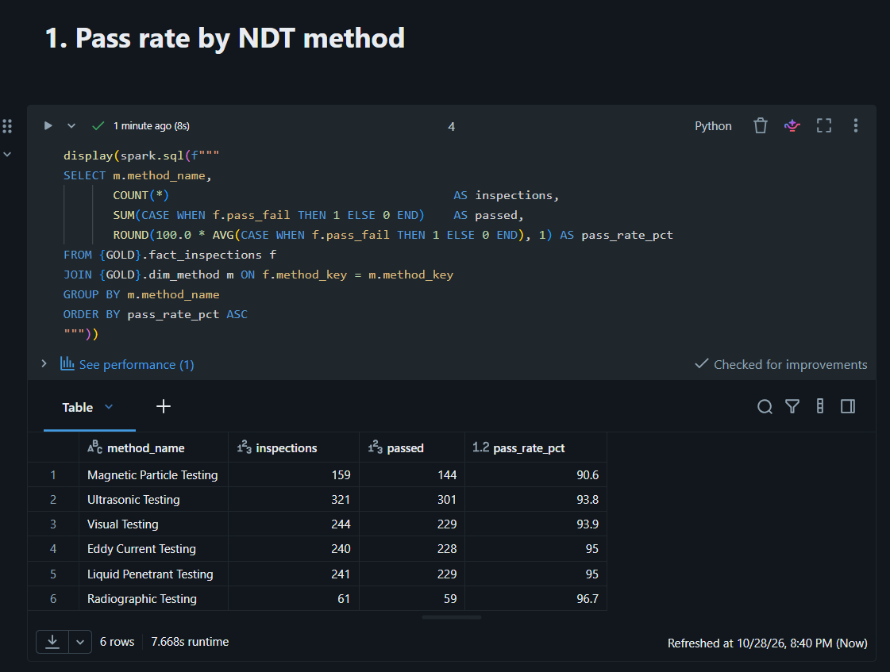

# NDT Inspection Lakehouse on Azure Databricks

A medallion pipeline that turns messy aviation Non-Destructive Testing (NDT) inspection records into an audit-ready star schema. It runs on Azure Databricks with Unity Catalog and Delta Lake, and it also runs on a laptop with plain Spark so anyone can try it without a cloud account.

The data is synthetic but built to behave like real MRO records: mixed file formats, duplicates, inconsistent casing, orphan keys, instruments that went out of calibration, and inspectors who were promoted during the period.The model itself comes from an earlier project, [ndt-data-model](https://github.com/mcnusair/aviation_ndt_data_model).

## The question behind it

For any inspection in maintenance you should be able to say who did it, with which instrument, and whether both were valid on that day. That needs history, not just the current state. So inspectors and equipment are SCD Type 2 dimensions, and every fact row points at the version that was valid on the inspection date.

The second rule I set myself was that nothing disappears quietly. A row that fails validation goes to a quarantine table with the reason next to it.

## How the data flows

```
Landing            Bronze              Silver                  Gold
raw files     ->   raw Delta      ->   cleaned and        ->   star schema
as delivered       tables              validated

CSV                explicit schemas    duplicates removed      7 dimensions
JSON lines         audit columns       dates parsed            1 fact table
multi-line JSON    unparseable rows    structs flattened       2 of the dimensions
folders of files   are kept            bad rows quarantined    keep history (SCD2)
weekly drops                           loads merged
```

There is a longer write-up with a diagram in [docs/architecture.md](docs/architecture.md).

## The data

Everything comes from `data_generator/generate_ndt_landing.py`, so the same seed always gives the same files.

- Facilities, components, work orders and certification history as CSV (6, 120, 185 and 12 rows)
- Methods, equipment and inspectors as JSON lines (6, 9 and 10 rows). Inspectors have nested fields
- 1,210 inspection lines covering 1,200 inspections from 2024
- 146 findings in one multi-line JSON file, each with an array of indications inside
- 2,434 ultrasonic thickness readings spread over 181 daily CSV files
- 27 calibration records in 9 JSON files
- Three weekly batches for January 2025, with 78 new inspections and a few corrections to old ones

## The model

One fact table at the grain of a single inspection, plus seven dimensions. The fact holds duration, pass or fail, indication count, the largest indication size and the hours until the next inspection. The full DDL with keys and constraints is in [sql/ndt_star_schema.sql](sql/ndt_star_schema.sql).

## Data quality

These are the problems I planted and how the pipeline deals with each one. More detail in [docs/data_quality.md](docs/data_quality.md).

- 10 exact duplicate lines: one row per inspection is kept, the most recently ingested.
- Results written as PASS, pass or Pass: normalised, then turned into a boolean.
- Dates in two formats (dd/MM/yyyy and ISO): both are parsed, anything else is rejected.
- Trailing spaces and empty strings used as nulls: trimmed, and empty becomes null.
- Clean inspections with a null size: set to 0, since no indications means no size.
- 3 negative durations: quarantined. Two of them are fixed by the January batch and leave quarantine through the MERGE.
- 8 instrument-based inspections with no instrument: quarantined. PT and VT are allowed to have none because they use consumables.
- 3 component IDs that do not exist: quarantined as orphans.

## What the queries found

The data is synthetic, so these are only a check that the queries surface what I planted.

- Magnetic particle testing has the lowest pass rate (90.6 percent) and radiographic testing the highest (96.7 percent).
- Steel flap tracks (ATA 27) fail 13 percent of the time, about double the next group.
- 14 inspections used a Zetec eddy current instrument after its calibration had expired, up to 41 days late. This is the audit question the SCD2 design was built for.
- Two inspectors went from Level 2 to Level 3 during 2024, and their older inspections still show the level they held back then.

## Screenshots from the Databricks run

I ran everything on Azure Databricks as six notebooks in order. The screenshots below show an example of individual notebook run on Databricks, successful run of all notebooks in a Workflow/job, Gold layer tables in catalog and finally, an example of the results of an analytics query.






## Running it

On Azure Databricks, follow [docs/running_on_databricks.md](docs/running_on_databricks.md). In short: create the Unity Catalog objects, upload the generated files to the landing volume, import the repo as a Git folder and run notebooks 01 to 06 in order, or put them in a Workflow.

Locally, with no cloud account (you need Java 17 for Spark):

```bash
python -m venv .venv && source .venv/bin/activate
pip install -r requirements.txt
python data_generator/generate_ndt_landing.py
python local/run_local.py
pytest -q
```

The local runner swaps Delta for Parquet and imitates MERGE with DataFrame operations. Delta-specific behaviour such as time travel and the transaction log only gets exercised on Databricks.

## Things that went wrong along the way

- I uploaded the files from Windows through WSL, and almost every file got a `:Zone.Identifier` copy next to it. Spark read those as data when I pointed it at a whole folder. The readers now filter by file extension.
- The MERGE statements were first tested for real on Databricks. Locally I could only check the result of an emulation.
- A catalog needs its external location to exist first. I created things in the wrong order once.

## Layout

```
notebooks/        pipeline notebooks 01 to 06, plus _common with the shared code
sql/              star schema DDL and the analytics queries
data_generator/   synthetic data, same seed every time
local/            local Spark runner
tests/            end to end test that runs in CI
docs/             architecture, design decisions, data quality, Databricks setup
```

