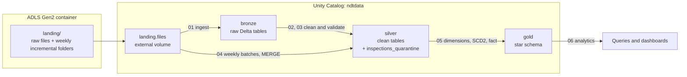

# Architecture

## How the data flows



## The four layers

Landing holds the files exactly as they arrive, in an external volume. I never touch them, and dropping the volume does not delete them.

Bronze is one Delta table per source, still raw. Schemas are explicit, every table gets an ingestion timestamp and the name of the file each row came from, and lines Spark cannot parse are kept in a _corrupt_record column. Dates stay as strings because the source mixes two formats.

Silver is where the data becomes usable. Text is trimmed, dates become real dates, nested structs are flattened, duplicates are removed, and every foreign key is checked. Rows that fail a check go to a quarantine table with the reason.

Gold is the star schema: surrogate keys, two dimensions that keep history, and one fact table at the grain of a single inspection.

## Access setup

```
Access connector (managed identity)
        |  Storage Blob Data Contributor on the storage account
        v
ADLS Gen2 storage account  <--  external location (credential + abfss:// path)
        ^                                  ^
        |                                  |
storage credential  ----------------------+
        |
        +--> catalog ndtdata (managed location = container root)
                +--> schemas: landing | bronze | silver | gold
                +--> external volume landing.files  ->  .../landing
```

Every read and write passes two checks. Unity Catalog decides what the user is allowed to do, and Azure decides what the access connector's identity is allowed to do. If either one says no, the request fails. This took me a while to get straight, because the error looks the same whichever side refused.

## Notebook order

- 01_bronze_ingestion reads the landing volume and writes the bronze tables.
- 02_silver_reference_data cleans everything except inspections.
- 03_silver_inspections validates inspections and writes silver.inspections and the quarantine table.
- 04_silver_incremental reads the weekly folders and merges them into silver.
- 05_gold_star_schema builds the dimensions and the fact table.
- 06_analytics runs the business queries on gold.

_common holds the shared configuration, readers, writers and the clean_inspections function. Each notebook pulls it in with %run.

## Re-running

Notebooks 01, 02, 03 and 05 overwrite their output, so running them again gives the same result. Notebook 04 remembers the file date of every batch it has loaded and skips those, so a second run changes nothing.
