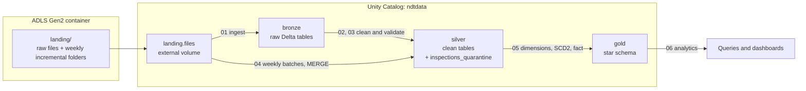

# Architecture

## Flow



## Layers

| Layer | Purpose | Rules |
| --- | --- | --- |
| Landing | Files exactly as delivered, in an external volume | Never modified. Dropping the volume does not delete the files |
| Bronze | One Delta table per source, raw | Explicit schemas, audit columns (`ingestion_ts`, `source_file`), corrupt rows kept in `_corrupt_record`, dates stay strings |
| Silver | Clean, typed, validated business data | Trimmed text, real dates, flattened structs, deduplicated, referentially checked, bad rows quarantined with reasons |
| Gold | Star schema for analytics | Surrogate keys, SCD2 dimensions, one fact table at the inspection grain |

## Governance setup

```
Access connector (managed identity)
        |  Storage Blob Data Contributor on the storage account
        v
ADLS Gen2 storage account  <--  external location (credential + abfss:// path)
        ^                                  ^
        |                                  |
storage credential  ----------------------+
        |
        +--> catalog ndtdata (managed location = container root)
                +--> schemas: landing | bronze | silver | gold
                +--> external volume landing.files  ->  .../landing
```

Two checks apply to every read and write. Unity Catalog checks what the user may do. Azure checks what the access connector's identity may do. If either says no, the request fails.

## Notebook order

| Notebook | Reads | Writes |
| --- | --- | --- |
| `01_bronze_ingestion` | landing volume | `bronze.*` |
| `02_silver_reference_data` | bronze | `silver.*` (everything except inspections) |
| `03_silver_inspections` | bronze, silver reference | `silver.inspections`, `silver.inspections_quarantine` |
| `04_silver_incremental` | landing `incremental/` | bronze incremental tables, `MERGE` into silver |
| `05_gold_star_schema` | silver | `gold.*` |
| `06_analytics` | gold, quarantine | query results |

`_common` holds the shared configuration, readers, writers and `clean_inspections`, and is pulled in with `%run`.

## Re-running

Every notebook can be re-run. Notebooks 01, 02, 03 and 05 overwrite their outputs. Notebook 04 remembers the `file_date` of every batch it has loaded and skips them, so a second run changes nothing.
